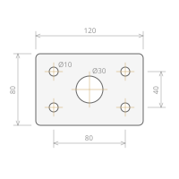
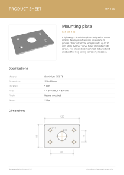

# Canvas PHP

**Draw once, compose endlessly.**

Canvas PHP is an object-oriented graphics library that combines drawing and document generation through a single, consistent PHP API. Create technical drawings, product illustrations, catalogs and PDF documents using the same graphical foundation, and export them to **SVG, DXF, PNG, JPEG and PDF**.

<p align="center">
	
</p>

📖 **Documentation : [ben-sta.github.io/canvas-php](https://ben-sta.github.io/canvas-php/)**

## Everything is a Canvas

A Canvas can be used as a standalone drawing or a reusable graphical component. Components can be combined into assemblies and integrated into larger drawings or documents.

| Component | Assembly | Document |
|---|---|---|
| Create reusable graphical components from simple shapes and elements. | Combine reusable graphical components to build complex assemblies. | Integrate drawings, text and images into complete, structured documents. |

## Built for reuse, not repetition

Why recreate the same geometry for every document ? Canvas PHP allows graphical components to be reused, drawings to be generated from parameters, and multiple documents to share the same drawing logic. Less duplicated code, simpler maintenance and more consistent results.

## One engine, many possibilities

| Technical drawings | Product catalogs | PDF documents |
|---|---|---|
| Precise drawings of mechanical parts and technical assemblies. | Detailed product illustrations, specifications and datasheets. | Structured documents combining drawings, text and images. |

Start with a shape. Build a component. Compose an entire document. Canvas PHP provides a consistent foundation for graphical projects of any size.

## Requirements

Canvas PHP relies on standard PHP functionality, with additional extensions required for certain rendering features.

| Requirement | Description |
|---|---|
| PHP | Tested with PHP 8.3 |
| GD | Required for PNG and JPEG output, with FreeType support for text |
| Zlib | Required for PDF output |
| Ctype | Required for hexadecimal color validation |

SVG and DXF output only require Ctype. PDF output uses its own rendering engine and does not require GD.

## Installation

Canvas PHP is distributed as a single PHP file. No Composer, autoloader or build tools are required. Download [`canvas.php`](canvas.php) and include it in your application :

```php
require_once __DIR__ . '/canvas.php';
```

Canvas PHP provides dedicated rendering classes for SVG, DXF, PNG, JPEG and PDF documents, each with a shorter alias :

| Class | Alias |
|---|---|
| `canvas_svg` | `svg` |
| `canvas_dxf` | `dxf` |
| `canvas_png` | `png` |
| `canvas_jpg` | `jpg` |
| `canvas_pdf` | `pdf` |

Canvas PHP supports TrueType ( .ttf ) fonts for drawing text. Fonts are only required when your drawings include text.

## Quick start

### Create a component

A Canvas holds graphical elements independently of any output format.

```php
require_once __DIR__ . '/canvas.php';

$component = new canvas();

$component->stroke_color( '#CDA869' );
$component->stroke_width( 2 );
$component->fill_color( '#F9F9F9' );
$component->rectangle( 20, 20, 80, 80, 10 );

$component->fill_color( '#FFFFFF' );
$component->circle( 60, 60, 20 );
```

### Compose a drawing

Add the component to an SVG drawing using append(), then translate it to reuse it at a different position.

```php
$drawing = new svg( 240, 120 );

$drawing->append( $component );

$component->translate( 120, 0 );
$drawing->append( $component );

$drawing->save( __DIR__ . '/drawing.svg' );
```

### Export to PDF

The same graphical content can be reused with another rendering engine.

```php
$pdf = new pdf( 240, 120, 'px' );

$pdf->append( $drawing );
$pdf->save( __DIR__ . '/drawing.pdf' );
```

Both documents are generated from the same graphical elements, without duplicating the drawing logic.

## Formats

All formats share the same API, but some features depend on the output format :

| Feature | SVG | DXF | PNG | JPEG | PDF |
|---|:-:|:-:|:-:|:-:|:-:|
| Fill | ✓ | ✗ | ✓ | ✓ | ✓ |
| Stroke transparency | ✓ | ✗ | ✗ | ✗ | ✓ |
| Text and paragraphs | ✓ | ✓ | ✓ | ✓ | ✓ |
| Embedded fonts | ✓ | ✗ | - | - | ✓ |
| Images | ✓ | ✗ | ✓ | ✓ | ✓ |
| Layers | ✓ | ✓ | ✗ | ✗ | ✓ |
| Links | ✓ | ✗ | ✗ | ✗ | ✓ |
| Pages, bookmarks and metadata | ✗ | ✗ | ✗ | ✗ | ✓ |

DXF text uses the font name only. The font must be installed in the CAD application. Images cannot be exported to DXF.

## Examples

### Technical drawing

A dimensioned mounting plate drawn once and exported to SVG, PDF, DXF, JPEG and PNG. The hole() and dimension() functions create each hole and dimension with a single call, and outlines, axes and dimensions are placed on separate layers.

<p align="center">
	
</p>

Source : [`examples/technical_drawing.php`](examples/technical_drawing.php)

### Product sheet

An A4 product sheet combining a photo, a justified description, a specification table and the technical drawing of the first example, reused as a vector drawing.

<p align="center">
	
</p>

Source : [`examples/product_sheet.php`](examples/product_sheet.php)

## License

Canvas PHP is released under the [MIT License](LICENSE).

The Montserrat font used in the examples is licensed under the [SIL Open Font License 1.1](examples/OFL.txt).
